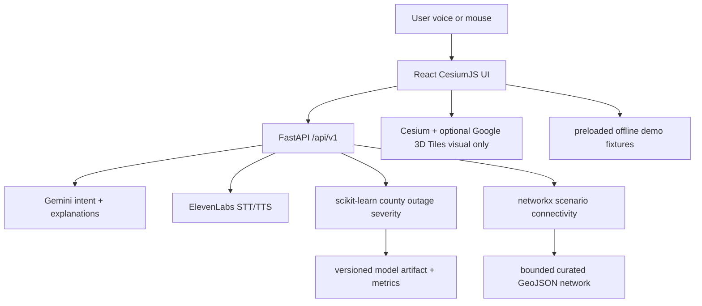

# Technical Architecture

## Topology


## Monorepo
```
apps/web/src/{app,components,features/globe,features/scenarios,features/inspector,features/voice,services,styles}
apps/api/app/{main.py,schemas.py,routes/{health,predict,scenarios,network,interpret,voice}.py,services/}
apps/api/tests/
packages/contracts/{schemas,generated-types}
ml/{train.py,prepare.py,evaluate.py,config.yaml,tests,artifacts/}
data/{fixtures,processed/.gitkeep,provenance/}
contracts/{scenario.schema.json,command.schema.json,example-scenario.json,example-command.json}
docs/ prompts/ skills/interface-craft/
```

## Browser architecture
- Cesium viewer created exactly once via React ref and destroyed cleanly on unmount. Isolate Cesium imperative API from React component lifecycle.
- Store UI selection/scenario in Zustand. Server state (predictions, jobs) in TanStack Query.
- GeoJSON overlays loaded as independent entities with versioned IDs. Clear outdated overlays on state update. 3D tile loading is nonblocking; re-enable basic globe fallback if Google tiles fail.
- All user interactions become normalized typed `Command` dispatched through a single state controller. No model code runs in map render loop.
- Camera position/zoom saved in URL query or local state, not backend DB.

## Backend architecture
- FastAPI serves endpoints under `/api/v1`. Use Pydantic v2, CORS allowlist, rate limiting/cost caps, structured errors, `/healthz` and `/readyz`.
- Use lifespan load to cache joblib ML model and metadata in memory, avoid loading on every request.
- Scenario service verifies all model features are in training feature schema and supported ranges; rejects unknown params. `prediction.mode` is either `trained_conditional` or `offline_example`.
- Graph service loads bounded local graph GeoJSON and computes connectivity, reachable facilities, cut edges, weighted service access. This is intentionally NOT power-flow simulation.
- Gemini receives a short state summary + allowlisted tool signatures; returns command proposals only, backend validates and frontend confirms. No arbitrary code execution or browser URLs from user speech.
- ElevenLabs integration via server-side credentials; VAD/streaming optional, push-to-talk file upload enough. Short TTS voice narration if ready.
- JSON fixtures are public domain/project-generated; sensitive credentials stay in server environment. No database needed.

## Deployment
- Frontend Vercel; Python API on Render/Fly/Railway or equivalent with accessible model artifact. Pick based on team's configured accounts, not assumption of free compute.
- Configure environment `VITE_API_BASE_URL`, `VITE_CESIUM_ION_TOKEN` (Cesium public tokens as documented, restricted), Google tile keys restricted per provider, server `GEMINI_API_KEY`, `ELEVENLABS_API_KEY`, `ELEVENLABS_VOICE_ID`, `MODEL_PATH`, `CORS_ORIGINS`.
- Never put backend Gemini/ElevenLabs secret in VITE_* variables. Review Maps API billing limits and legal terms.

## Provider failure modes
No Gemini: typed controls continue. No ElevenLabs: text input continues. No 3D tile API: Cesium basic globe + sourced overlay continues. No trained model: offline example explicitly labeled, no false model claim. No backend: static interactive demo still plays with fixed clearly labeled fixture.
