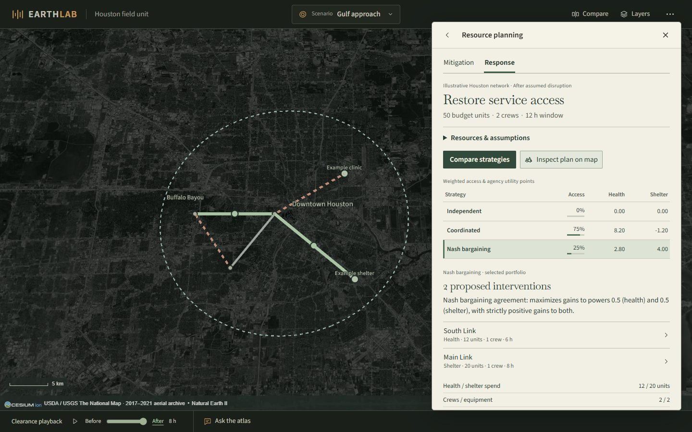

# Houston resource planning

Open the Houston atlas and choose **Study menu → Resource planning**. For a quick rehearsal, select **Response**, compare **Independent**, **Coordinated** and **Nash bargaining**, then choose **Inspect plan on map**. Play through the selected plan, tap a link and inspect the access change when its action is removed. Set the shared budget to zero under **Resources & assumptions** and compare again to see the disagreement fallback.



## Reproduce the comparison

After the root dependencies are installed, `pnpm demo:allocation` runs both cases through FastAPI in-process. `pnpm dev` runs the atlas and allocation API. `pnpm dev:integrated` also runs AquaGrid after its separate setup.

The following response results use 50 shared budget units, two crews, two equipment units, a 12-hour window, equal bargaining weights, and the disruptions declared in the checked-in fixture.

| Strategy | Health utility | Shelter utility | Weighted access | Spend | Links |
|---|---:|---:|---:|---:|---|
| Independent | 0.00 | 0.00 | 0% | 0 | None |
| Coordinated | 8.20 | −1.20 | 75% | 40 | Main and north |
| Nash bargaining | 2.80 | 4.00 | 25% | 32 | Main and south |

One agency working alone cannot reconnect a facility in this case. Independent best responses settle on no work and exhaustive unilateral checks verify that neither agency can improve alone under the shared limits. Coordination assigns each agency a welfare weight of one and maximizes the sum of their utilities. Bargaining requires a gain for both over disagreement and maximizes their weighted product. With the default preferences, funding the shelter connection meets that condition. When the feasible set contains no positive-gain agreement, the result explicitly returns the disagreement portfolio.

## Model and map

- The solver reuses the existing NetworkX Houston fixture, including five links, one staging origin and two fictional facilities. Each agency can sponsor one option on each link. Agency budgets and crew caps, shared resources, time and exclusive use of each link bound the search. The solver considers up to 32 portfolios per agency and at most 243 feasible joint assignments before the resource caps are applied.
- Agency utility is the sum of clinic and shelter access weighted by the agency's priorities, minus 0.1 point per unit it spends. Access to each facility is its intact shortest-path cost divided by its scenario cost, capped at one. An unreachable facility scores zero. The comparison's weighted access uses the fixture's clinic and shelter service weights of nine and three.
- Response uses the declared disruption. Mitigation averages access across three illustrative states with weights of 10% intact, 10% impaired and 80% declared disruption. The footprint tests exposure geometrically. Users set disruption separately. The county-level outage model supplies no street-level condition estimates.
- All selected actions run in parallel. Each completion changes the modeled network at the corresponding hour. The atlas displays the solver's paths for the declared disruption and each phase's computed service access. The input, graph and assumption-set revisions travel with the result. The timestamp identifies the assumption set.
- **Ask the atlas** proposes bounded planning edits for confirmation. Spoken summaries read computed text. Local examples and manual controls work without provider credentials. If the API goes offline, the ledger labels the bundled phase and distinguishes pending edits from the last computed portfolio.
- Site geometry, budgets, work durations and intervention effects are illustrative. Geographic route tests for hospitals use the separate regional AquaGrid model. Neither model establishes safe passage, field crew availability, or observed road conditions.

## API and source files

`GET /api/v1/allocation/demo` returns the seeded request. Post that request to `/api/v1/allocation/scenarios/evaluate` for the catalog and baseline or `/api/v1/allocation/plans/compare` for the three strategies. Results include graph IDs, utilities and spend, leave-one-action-out access, completion frames, service paths, a payoff table and provenance. Examples in PowerShell with the API running locally:

```powershell
$api = 'http://127.0.0.1:8000/api/v1/allocation'
$case = (Invoke-RestMethod "$api/demo").data
$case.phase = 'response'
$body = $case | ConvertTo-Json -Depth 8
(Invoke-RestMethod "$api/plans/compare" -Method Post -ContentType 'application/json' -Body $body).data.strategies
```

The solver and tests live in `apps/api/app/services/allocation.py` and `apps/api/tests/test_allocation.py`. The shared schema is `contracts/api.schema.json`. The atlas implementation lives in `apps/web/src/features/allocation/`, and both phase snapshots are in `data/fixtures/allocation/`. Authored WGS84 geometry comes from `data/fixtures/network-houston.geojson`. Review the [approved contract proposal](../proposals/allocation-module.md).

## Verification

Run `pnpm typecheck`, `pnpm test`, `pnpm contracts:check`, `pnpm openapi:check` and `pnpm build` from the root. The allocation tests exercise constraints, exact best responses, independent utility recomputation, Nash gain optimality, tie handling, deterministic fixtures, exposure semantics and partial playback.

With the stack running and the [browser QA package](../../simulator/qa) installed, run `node simulator/qa/verify-planning.mjs`. Set `QA_CHROME_PATH` for a system Chrome executable. The browser checks use 1440×900 desktop and 390×844 emulated touch, compare the displayed result to the HTTP response, click the geographic link, scrub or play the plan, exhaust the budget, and disconnect the API.

All four additional zones passed playback and pin-to-facility routing from the atlas on both desktop and emulated touch. For another machine, rebuild the regional datasets and models locally. Prepared geography and fitted model binaries live in the ignored `simulator/data` directory. See the [regional training handoff](houston-simulator-zones.md) and [browser checks](../../simulator/qa/README.md).

The integrated run passed 123 web tests, 154 Python tests, three simulator catalog tests, both production builds and the generated-contract checks. Three optional ML modules skipped in the base Python environment. In the separate ML environment, 11 tests passed and 12 artifact-dependent cases skipped because the county model artifact or processed training data was absent. Browser checks verified the mounted planning and confirmation flows on desktop and emulated touch. ElevenLabs success behavior was tested with a simulated provider response. The credential-free browser rehearsal verified its text fallback.
